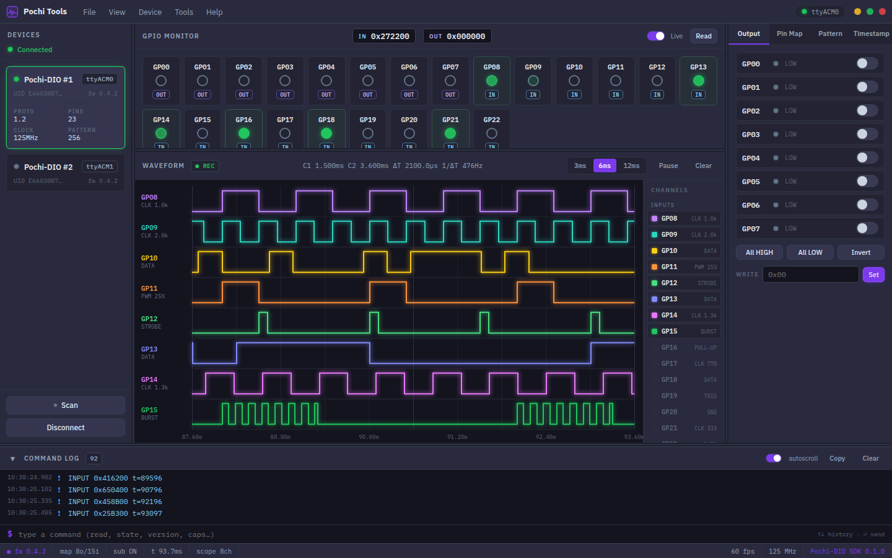

# GUI Design Reference

Canonical UI reference for the Tcapi Tools GUI — the original prototype
sources, byte-identical to the designer's `tcapi.zip` drop. The
production GUI must match this prototype exactly. Open `index.html` in
a browser to run it (loads React 18 UMD / Babel / fonts from CDN; a
fully self-contained 1.6 MB variant lives outside git in
`gui/src/mocks/`).

## Files

| File | Contents |
|------|----------|
| `index.html` | Entry point; defines script load order |
| `app/theme.css` | Instrument theme: `:root` design tokens, shared component classes (`.btn`, `.dot-led`, `.seg`, `.chip`, `.switch`, `.field`, …) |
| `app/app.jsx` | App shell: MenuBar, layout + resizers, RightDock tabs, StatusBar, appearance defaults (`TWEAK_DEFAULTS`) |
| `app/store.jsx` | Global store (version-key + `useSyncExternalStore`) **and the device simulation** |
| `app/panels-device.jsx` | DevicePanel (left): device cards, scan/connect/disconnect |
| `app/panels-gpio.jsx` | GpioMonitor (center top): pin grid (23 pins in the prototype; 25 channels in v2, see below), IN/OUT readouts, Live toggle |
| `app/waveform.jsx` | WaveformViewer: Canvas 2D scope renderer, cursors, channel list |
| `app/panels-output-map.jsx` | OutputControl + PinMapEditor (right dock tabs) |
| `app/panels-pattern-ts.jsx` | PatternEditor + TimestampViewer (right dock tabs) |
| `app/panels-log.jsx` | CommandLog: log lines + REPL input |
| `app/tweaks-panel.jsx` | Mock-framework tweaks scaffold (not ported) |

## Reuse guide (per the prototype author, confirmed by analysis)

**Use as-is** (mechanical module conversion only — wrap IIFE/window
globals into `import`/`export`, no changes to structure, inline style
values, or class usage):

- `theme.css` — adopt verbatim as the app's global stylesheet
  (swap the Google Fonts `@import` for bundled IBM Plex woff2,
  SIL OFL 1.1)
- All panel components: JSX structure, inline styles, pointer
  behaviors
- `waveform.jsx` Canvas rendering logic (graticule, lanes, cursors,
  glow) — feed it an edge-history ring buffer instead of the
  simulation's pure functions
- The pattern timing-preview SVG in `panels-pattern-ts.jsx`

**Replace internals, keep the interface**:

- `store.jsx` — keep the store mechanism (version keys +
  `useSyncExternalStore`) and the action names; replace the
  simulation half (`GEN_PRESETS`, `genValue`, `tick()`, fake
  responses) with Tauri `invoke`/`listen` calls per the mapping
  table in the wiki GUI spec (§9)
- React 18 UMD + in-browser Babel → React 19 + Vite + TypeScript

**Do not port**:

- `app/tweaks-panel.jsx` — preview-time design scaffold. Only the
  option set and defaults in `app.jsx` carry over (as the Settings
  feature)

## Protocol v2 adaptation (production GUI)

The prototype sources stay untouched (they simulate a v1 device). The
production GUI keeps their look and structure and differs only where the v2
protocol (`proto=2`) changed the device model; none of this alters styles
or layout:

- **25 channels instead of 23 pins.** The grid, the pin map strip and the
  waveform channel list cover ch0-ch24 = GP0-GP22, GP26, GP27 (GP23-GP25
  are not DIO). The label of a channel is its GP pin (`GP26`); the tooltip
  also names the channel (`GP26 (ch23)`).
- **Per-channel pin map.** The v1 "one split + one pull mode + two flag
  bits" model is replaced by the v2 map (direction mask, pulls, polarities,
  edge mask). The strip keeps the draggable boundary (it rewrites the
  direction mask as "ch0..n-1 outputs"), the pull buttons set every input,
  and the two flag checkboxes became one "Change-notify on inputs"
  checkbox (the `edge` mask). "Timestamp capture enabled" has no v2
  counterpart and is gone; "Open-drain" stays a local checkbox.
- **Pattern hold in ticks.** The step table keeps its "hold µs" column; the
  value is sent as 200 ns ticks and must be a whole number of ticks.
- **No sync push event.** v2 has no `SyncDone`.
- **TOML files** (map, pattern) are evaluated by the SDK config parser; the
  GUI contains no TOML parser.

The full written spec lives in the project wiki (`ja-GUI-Spec`); when
the wiki and these sources disagree, these sources win.
